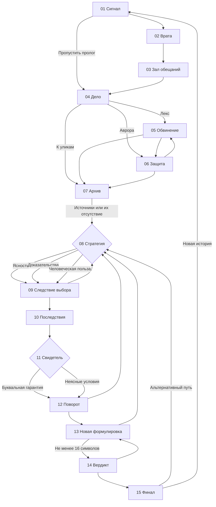

# Граф состояний

Данные состояния: `scene`, `history`, `visited`, `collectibles`, `claim`, `evidence`, `evidenceStatus`, `strategy`, `witness`, `rewrite`, `verdictIssued`, `journey`. Переходы проверяются в `src/engine.js` и имеют единое API `choose`, `back`, `revisit`, `collect`, `setDraft`. Список сцен задан отдельно, в `src/data.js`. UI контроллер `src/app.js` выполняет только визуализацию и вызов методов движка.

## Ограничения

- Нельзя сгенерировать вердикт без осмысленного исправленного текста.
- Выбор стратегии изменяет запись и сбрасывает вердикт.
- Редактирование исходного утверждения сбрасывает зависимые решения.
- Можно вернуться только к посещённым сценам.
- Возражения свидетеля влияют на контекст вердикта, но не являются реальными отзывами покупателей.
- Разглашения через внешние API нет: подготовка JSON является локальным экспортом без автоматически созданной рекламы.
