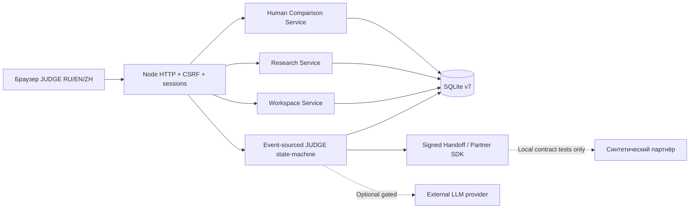
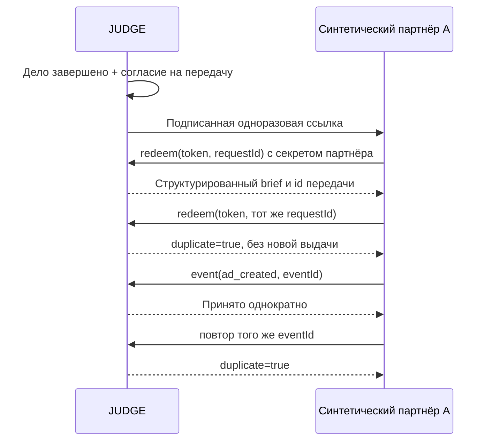

# ADVERSE JUDGE: 5 WAVE — техническое описание реализации v0.10.0

Дата релиза: 22.10.2026. Основание: исходники ADVERSE JUDGE v0.5.0. Данный документ описывает **то, что реализовано в коде**, с указанием конкретных недоработок, а не планы как достижения.

## Архитектура

Нет платных npm-зависимостей. Используется экспериментальный `node:sqlite` Node.js >=22.13. SQLite обеспечивает односерверный пилот; он не заменяет планирование отказоустойчивого кластерного хранения.

**Источники истины:** сохранённые события по делу (`events`), отдельные факты голосований (`comparison_votes`), командные данные (`workspace_*`), решения исследований (`research_studies`). `event_attestations` подписывает порядок и содержимое событий; модель ИИ не вносит изменения в event-store без допуска бизнес-логики.

## WAVE 1 — TEAM STUDIO

### Пользовательская функция

Зарегистрированный человек создаёт рабочее пространство. Роль owner управляет приглашениями/участниками; reviewer может оставить замечание и поделиться собственным делом; viewer может читать **только явно опубликованные дела**, но не комментировать. Ни одна роль не получает через командный кабинет право вызвать `JudgeService.command` на чужом деле. Доступ к результату исходного автора не подразумевает владение оригиналом.

### Данные и API

- `workspaces`: id, owner_id, name, created_at.
- `workspace_members`: состав и роль, уникальный ключ `(workspace_id,user_id)`.
- `workspace_invites`: hashed token, TTL 3 дня, single-use, не более 20 активных ссылок, предел 25 участников.
- `workspace_cases`: явное связывание workspace/case. Дело **не видно** коллегам до публикации.
- `workspace_reviews`: комментарии с неизменяемым автором/временем; `workspace_events`: журнал командной активности.
- `GET/POST /api/workspaces`, `GET /api/workspaces/{id}`, `POST /api/workspaces/{id}/invite`, `GET/POST /api/workspaces/invitation/{token}`, `POST /api/workspaces/{id}/share`, `/unshare`, `/review`, `/remove-member`, `/delete`.

### Проверки

Хеширование приглашения, одноразовость, запрет гостей, запрет чтения чужих пространств, запрет комментирования viewer, сохранность приватных дел, удаление командных данных при удалении аккаунта. Ручной браузерный сценарий с реальными **двумя зарегистрированными пользователями**.

### Ограничения

Приглашения не привязаны к адресу email — ими владеет любой предъявитель токена. Рабочие пространства не предоставляют SSO, организации и внешние роли требуют доработки.

## WAVE 2 — RESEARCH STUDIO

### Пользовательская функция

Автор задаёт заранее гипотезу, цель 5–30 приглашённых ответов и связывает исследование с одним существующим, **действующим** слепым сравнением. После поступления добровольных ответов система показывает абсолютные количества, доли ответов A/B, долю «ни один» и Wilson 95% для доли **среди решивших A/B**. Исследователь однократно фиксирует редакторское решение `iterate`, `retain` или `inconclusive` с обязательным обоснованием. Если исходный вердикт устарел, разрешено только `inconclusive`.

### Данные и API

`research_studies`: гипотеза, снимок связи с verdict_id/comparison_id, target_responses, статусы, решение, обоснование, created_at/closed_at. Эндпоинты: `GET/POST /api/research`, `GET /api/research/{id}`, `POST /api/research/{id}/conclude`, `GET /api/research/export.csv`. Авторизация через ownership исходного дела. CSV с защитой формульных ячеек.

### Чего нельзя утверждать

Сравнение нерандомизированных приглашённых читателей не оценивает CTR, causal uplift или продажи. Интервалы Wilson имеют математический смысл только при статистических предположениях, которые данная выборка не обеспечивает. Без живых независимых голосов значения остаются нулевыми.

## WAVE 3 — RU / EN / 中文

Смена языка в шапке, персистентность в localStorage, перевод основных заголовков, навигации, форм команд и исследований, кнопок; даты форматируются согласно активной локали. Пользовательские рекламные тексты и комментарии **не переводятся автоматически** и не отправляются переводчику. Браузерные тесты проверяют RU→EN→zh и отсутствие горизонтального переполнения для 390 px.

**Степень готовности:** только функциональный международный MVP. В старых сценах/диалогах есть длинные русские блоки; полной локализации, независимой проверки носителями и WCAG-аудита нет.

## WAVE 4 — PARTNER CONTRACT

Модель `signed handoff → authenticated redeem → verified event receipt` уже присутствовала в v0.5 и сохранена. Добавлено комплексное живое испытание API (действительно отправляются локальные HTTP запросы, но **не** реальным рекламным сайтам).

Проверены чужие ключи и подписи, неконтрактные типы событий, конфликт requestId, сохранение event replay. `config/platforms.json` A–G — placeholder, поэтому `integrations:audit` показывает **0/7 configured**, и только ручной экспорт возможен без настоящего обмена. Для реального подключения нужны URL каждого сайта, их API/способы импорта, auth-контракт, секреты, перечень подтверждаемых событий и согласованный тестовый endpoint. Любые секреты — только на сервере.

## WAVE 5 — OPS / EVENT INTEGRITY

### Механика

`event_attestations` связывает события цепочкой digest для каждого `case_id`: `digest[i] = HMAC-SHA256(secret, case_id, id, type, data, timestamp, digest[i-1])`, либо SHA256 без ключа в локальном демо. `ledger_meta` хранит алгоритм и идентификатор ключа, **не сам секрет**. `JudgeService.audit()` требует совпадения состояния, replay и цепочки. Команды при повреждении журнала отвергаются, а `scripts/verify-db.mjs` выполняет read-only проверку SQLite, foreign keys и replay.

**Существенное ограничение:** новые digest для старых событий строятся в момент обновления до 0.10.0. Они подтверждают сохранность с этого момента, но не могут подтвердить подлинность информации до миграции. SHA256 без секрета не обеспечивает защиты от направленной подделки злоумышленником с write-доступом в базу.

`ops:retention` запускается **dry-run** и считает истёкшие неиспользованные ссылки и сеансы. `ops:retention:apply` удаляет только эти токены; ни голоса, ни дела, ни исследования не стираются. Должен выполняться оператором после проверенной резервной копии.

### Операционная готовность

Node.js >=22.13; APP_ORIGIN=https:// для сетевого хоста; Secure/HttpOnly/SameSite cookies, CSRF и точная проверка Origin; CSP и запрет произвольных файлов; данные только в SQLite с chmod600. Нет production-ready SSO, MFA, подтверждения email, сервиса восстановления, антибот-защиты, оффлайн-бэкапов и завершённого privacy compliance assessment. Эти пробелы преднамеренно **не маскируются** green-status.

## Проверки релиза

Запускаются `npm test`, `npm run check`, `npm run demo`, `npm run integrations:conformance`, `npm run integrations:audit`, `npm run ops:doctor`, браузерные `scripts/browser-smoke.py`, `scripts/browser-five-waves.py`. Отдельная репетиция обновления использует реальные модули из старого архива v0.5.0 и переносит 8 событий, один голос, сеанс и неизменное состояние. Описание в `reports/FIVE-WAVES-TEST-REPORT.md`.

## Принципы дальнейшего развития

1. Нет автоматического открытия приватных кейсов в команде.
2. Нет выдуманных «полезных действий» на платформах A–G.
3. Нет маркетинговых заявлений об эффективности по малой добровольной выборке.
4. Нет потери событий при обновлении базы; никаких in-place rollback без проверенной копии.
5. Переход к PostgreSQL / Supabase — отдельная проверяемая миграция; текущий v0.10.0 её не реализует.
