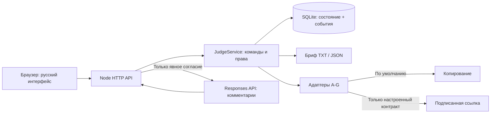
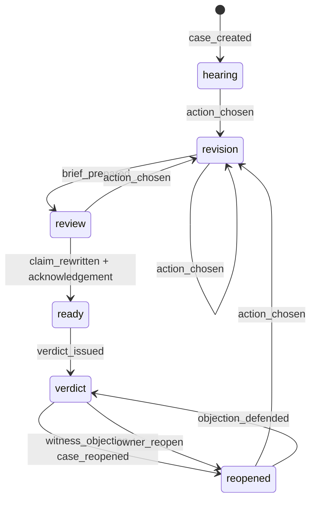
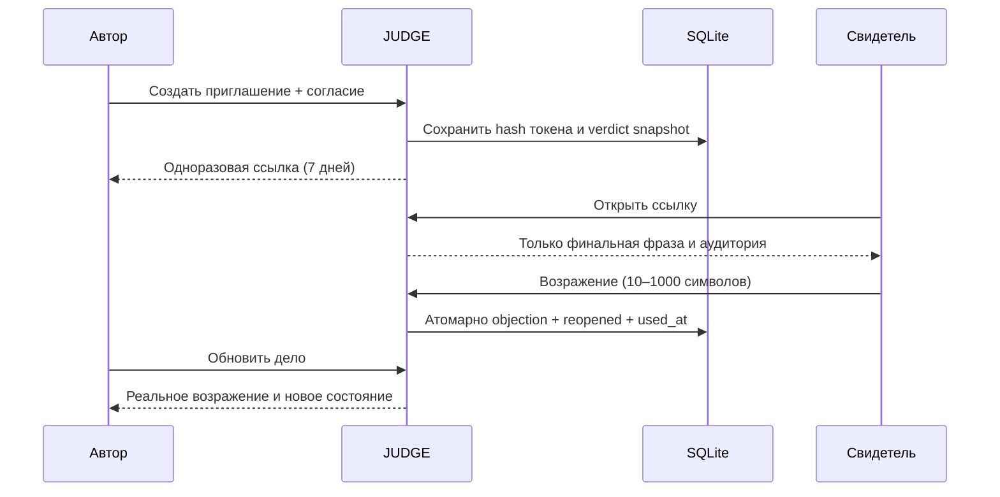

> **Актуализация v0.4:** см. `README_RU.md`, `docs/STAGING-OPERATIONS-RU.md`, `docs/RECEIVER-INTEGRATION-RU.md`. Ниже сохраняется историческая спецификация базового движка и v0.3, production readiness по ней не заявляется.

# Техническая спецификация JUDGE / ADVERSE

Версия продукта: **0.2.0 — локальный вертикальный прототип**. Документ описывает реализованное поведение отдельно от производственных требований.

## 1. Цель и граница

Проверить один причинный цикл: рекламное обещание → осмысленное действие → уточнённый текст → бриф → использование реального инструмента. Второй цикл: бриф → приглашение свидетеля → настоящее возражение → повторное рассмотрение. В этой сборке цикл внешнего инструмента заканчивается копированием, пока не подтверждены адреса и API семи работающих платформ.

Продукт не доказывает правдивость рекламы, не предсказывает продажи и не выдаёт юридическое разрешение. ИИ-роли — художественные интерфейсные роли, а не настоящие покупатели, юристы или сознательные персонажи.

## 2. Реализованная архитектура

Frontend — браузерные ES modules без CDN, сборщика и внешних шрифтов. Backend — один процесс Node. SQLite работает в WAL-режиме с foreign keys и busy timeout. Ни один runtime npm-пакет не требуется.

Это **не** прежняя целевая Next.js/TypeScript/PostgreSQL-сборка. Изменение принято для первого реального запуска без облачных секретов и без вмешательства в существующие сайты. Чистая доменная модель вынесена в `shared/domain.mjs`; её можно перенести в типизированный сервис после закрепления контрактов.

## 3. Пользовательские роли

**Гость:** открывает дело, проходит процесс, получает и экспортирует бриф. Принадлежность определяется случайной сессией HttpOnly cookie; данные не делают общедоступными.

**Локальный аккаунт:** имеет те же возможности и возможность повторного входа. При регистрации сохраняется идентификатор владельца гостевых дел; при входе в существующий аккаунт текущие гостевые дела переводятся этому аккаунту. Аккаунты не являются ADVERSE SSO. Email не подтверждён.

**Свидетель:** по capability-ссылке видит финальную фразу и аудиторию; один раз отправляет возражение. Не видит историю, источник, исходное обещание и аккаунт автора. Автор не может подать возражение из той же учётной записи; независимость реального человека не устанавливается.

**Оператор:** настраивает платформы и серверные секреты вне UI. Через интерфейс нельзя подменить API-адрес, пароль интеграции или источник подтверждённых событий.

**Внешняя платформа:** получает бриф по настроенному контракту и отдельно подтверждает согласованное действие своим серверным credential.

## 4. Автомат состояний

`ready` — промежуточная фаза внутри атомарной команды; клиент не выпускает отдельный незафиксированный «приговор». У каждого дела монотонная `version`. Каждая изменяющая команда содержит `commandId` и `expectedVersion`. Повтор уже выполненного commandId возвращает текущее дело с `duplicate:true` без второго события. Конфликт версии возвращает 409.

Для выпуска брифа нужны текст 5–1000 символов и явное подтверждение автора. В ветке основания необходимо описание не короче 10 символов; одна ссылка не заменяет основание.

Теперь при каждом изменении JUDGE сначала сверяет результат `replay(events)` с сохранённым снимком. При различии сообщает `INTEGRITY` и запрещает дальнейшую мутацию этого дела. Это защита от случайной порчи и одностороннего редактирования, **не криптографическая неизменность журнала**.

События являются источником реконструкции. Снимок и журнал меняются в одной SQLite-транзакции. `replay(events)` воспроизводит состояние; тест сравнивает его со снимком. Приложение не предоставляет редактирование событий, но журнал не является криптографически неоспоримым: администратор базы технически может изменить файл.

## 5. Экранная спецификация

| Экран | Первое полезное действие | Реализованное завершение |
|---|---|---|
| Обзор | Открыть учебное дело / свою фразу | Создано дело в гостевой сессии |
| Новое дело | Ввести обещание | Сервер проверил длину и создал событие |
| Рассмотрение | Выбрать один из трёх способов защиты | Сохранён выбранный путь |
| Редактор основания | Указать продукт, аудиторию, факт и CTA | Получены три шаблонных формулировки |
| Формулировки | Выбрать и вручную изменить текст | Выпущен редакторский бриф |
| Вердикт | Скачать, скопировать, пригласить свидетеля | Скачан результат / создано приглашение |
| Свидетель | Написать содержательное возражение | Дело автора открыто повторно |
| Мои дела | Найти и открыть своё дело | Сохранённое состояние восстановлено |
| Семь платформ | Увидеть честный статус A–G | Никаких ложных зелёных подключений |
| Настройки | Экспорт, локальный вход, удаление | Реальное действие в активном хранилище |

Интерфейс — русский, системные шрифты, крупные заголовки, спокойный светлый рабочий фон и тёмная навигация. Поддержаны мобильные размеры, keyboard focus, подписи полей, reduced motion и диалоговые окна. Полная сертификация WCAG не проводилась; отдельный аудит скринридером остаётся задачей.

## 6. Три редакторские роли

**Лекс:** выявляет ограниченный набор неопределённостей, гарантий и сравнений. Его функция — сильное возражение, не постановление о нарушении закона.

**Аврора:** сохраняет привлекательность, предлагая контекст или изменение функции фразы. Она не добавляет факты о продукте.

**Свидетель 404:** задаёт вопрос о практической пользе. Это сценарная роль; настоящий приглашённый свидетель отдельно вводит собственное возражение.

По умолчанию реплики выбираются детерминированно из фазы и действия. Варианты объявления — шаблонные комбинации факта, аудитории, вопроса и CTA автора. Автоматической «гениальной генерации» эта версия не обещает.

Опциональная модель получает ограниченное состояние и возвращает только `{lex, aurora, witness}`. Сервер проверяет состав полей, типы и длину. JSON Schema обеспечивает структуру, но не истинность текста. Модель не получает tools, права записи или авторитетного голоса при вынесении вердикта.

Настроены `store:false`, `max_output_tokens:900`, тайм-аут 20 секунд, отдельное согласие перед передачей, дневной лимит попыток и ограничение по владельцу. Дневной лимит — ограничение запросов, не гарантированный денежный потолок. Повторный AI commandId резервируется до вызова; повторные запросы этой команды не должны повторять оплачиваемый вызов.

## 7. Модель данных

| Таблица | Назначение | Граница доступа |
|---|---|---|
| users | id, email, scrypt password hash | Через сервер, только локальный аккаунт |
| sessions | SHA-256 токена, owner, CSRF, expiry | Токен клиенту только в cookie |
| cases | owner, state JSON, version | Проверка owner во всех пользовательских операциях |
| events | case, type, data, timestamp | Только автор через detail/export |
| commands | case + commandId | Уникальность повторных команд |
| invites | hash токена, снимок фразы, verdict, expiry/revoke/use | Ограниченный публичный read по токену |
| handoffs | неизменяемый снимок брифа | Автор / согласованная интеграция |
| integration_receipts | platform + eventId, handoff | Уникальные подтверждения |
| ai_requests | день, владелец, статус попытки | Ограничение использования |
| ai_reservations | case + commandId, request | Не повторять внешний вызов одной команды |

Доступ к SQLite-файлу имеет серверный процесс и оператор хоста. Шифрование базы на диске этой версией не реализовано. TLS нужен при удалённом развёртывании.

## 8. Последствия и приглашения

Ссылка не отправляется автоматически по почте: автор копирует её сам. Уведомлений вне интерфейса, фонового мониторинга и WebSocket-потока нет. Автор видит событие после открытия/обновления дела. Неиспользованные приглашения к старому приговору отзываются при выпуске нового.

## 9. Контракты платформ A–G

По умолчанию все семь адаптеров работают в режиме `clipboard`, `verified:false`. Реальные функции сайтов не выдумываются.

**Подписанный deeplink:** после явной настройки оператором создаётся токен HMAC-SHA256 с id передачи, id платформы, expiry и версией протокола. Сам текст брифа в URL не включается. Получающий сервер предъявляет свой credential и токен в `/api/integrations/redeem`; бриф выдаётся один раз. Полученный токен всё равно является секретом доступа к операции и должен исключаться из журналов URL на стороне получателя.

**Подтверждение:** `/api/integrations/events` принимает только согласованные `confirmedEvents`, правильную платформу и уже полученную передачу. Повторы eventId не увеличивают счётчик. Это аттестация партнёра, не доказательство независимой системы измерения.

**Прямой API:** заготовка отклоняет вызов без конкретного реализованного контракта. Успех не имитируется. Перед подключением необходимы: тестовая площадка, схема полей, credential, описание ошибок, тайм-аутов и идемпотентности, согласованное полезное событие.

## 10. Безопасность и приватность

Реализованы: случайные 256-битные session/invite tokens; хранение hash; HttpOnly/SameSite Strict; Secure при HTTPS APP_ORIGIN; проверка Host, Origin и CSRF; параметризованный SQL; экранирование авторского/модельного текста; CSP без сторонних scripts; запрет iframe; no-referrer; no-store; ограничения размеров; сессионная авторизация; отзыв приглашений; лимиты запросов и числа дел.

Не реализованы: производственная проверка почты, восстановление пароля, MFA, управление командами, распределённый limiter, отдельный WAF, юридически утверждённая retention policy, автоматическое удаление осиротевших гостевых данных, encrypted-at-rest, секрет-хранилище, независимый пентест.

Запрещено передавать service-role ключ в frontend при будущей миграции на Supabase. На производственной БД RLS и grants должны проверяться отдельными отрицательными тестами по tenant/owner; наличие названия Supabase само по себе не обеспечивает изоляцию. В текущей SQLite-версии RLS Supabase не существует и не заявляется.

## 11. Измерения

Сейчас сохраняются серверные события `case_created`, `action_chosen`, `brief_prepared`, `claim_rewritten`, `verdict_issued`, `witness_invited`, `witness_objection`, `case_reopened`, `objection_defended`, `handoff_created`, `handoff_redeemed`, `useful_action`, `ai_commentary`.

Карточки кабинета показывают только события владельца. Нет случайных пользователей, фальшивых просмотров и демонстрационной выручки. `verdict_issued` — число выпусков брифа, а не обязательно число уникальных дел; подпись в UI соответствует этому.

Конверсию landing→start сейчас считать нельзя: нет утверждённого счётчика квалифицированных визитов. CAC, ARPPU и выручка не показываются — нет расходов и платежей. Недельный возврат не выдаётся как известная метрика до появления согласованного события сессии. Следующий пилот должен отдельно определить denominators, идентификацию повторных гостей, согласия и наблюдаемое полезное действие внешнего сайта.

## 12. Критерии приёмки текущей сборки

1. `npm start` запускает локальный сервер без npm-зависимостей и облачных ключей.
2. Все три действия приводят к редактируемому брифу через допустимые состояния.
3. Результат переживает закрытие и открытие SQLite; журнал воспроизводит тот же снимок.
4. Запрос от другого владельца не читает и не меняет дело.
5. Повтор команды не создаёт второго события; конфликт версии не теряет чужое изменение молча.
6. Одноразовое возражение другого пользователя реально переводит дело в reopened.
7. Истёкшее или отозванное приглашение не работает.
8. Экспорт не содержит паролей, session credentials или открытых invite tokens.
9. Неподключённая платформа не возвращает имитацию успешного результата.
10. Текст с HTML не исполняется в интерфейсе.
11. Нет горизонтального скролла на проверенных экранах при 390, 768 и 1440 px.
12. Тесты сопровождаются честным перечислением непроверенных внешних зависимостей.

## 13. Следующий производственный этап

**Сначала:** пользовательский тест на не конфиденциальных данных; наблюдать, создают ли люди полезный бриф и пытаются ли применить его вне JUDGE. Не ставить универсальную норму конверсии без исходной базы.

**Затем:** один выбранный существующий сайт, один проверенный handoff-контракт и подтверждённое действие. Только после этого размножать интеграцию на остальные шесть.

**Авторизация и данные:** перейти к подтверждённым аккаунтам и PostgreSQL; согласовать модель tenant/organization; включить и протестировать RLS, миграции, резервирование, очистку гостевых данных, export/delete процедуру и восстановление доступа.

**Эксплуатация:** независимый security review, автоматизированный native browser E2E в CI, тесты нагрузки, error monitoring без текстов дел, лимиты модели, контроль стоимости, доступность и документация поддержки.

**Международная версия:** вынести копирайтинг из JS в словари, добавить английский интерфейс и отдельный корпус языковых правил. Китайский и другие рынки требуют не только перевода кнопок, но и проверки редакторских правил носителями языка. Сейчас реализован русский интерфейс.

## 14. Первичные технические источники

Проверены при подготовке реализации; это источники документации, не доказательства работоспособности наших интеграций.

- Node.js SQLite: https://nodejs.org/download/release/latest-jod/docs/api/sqlite.html
- Responses API: https://developers.openai.com/api/reference/resources/responses/methods/create
- Structured Outputs: https://developers.openai.com/api/docs/guides/structured-outputs
- Supabase RLS, для будущей миграции: https://supabase.com/docs/guides/database/postgres/row-level-security

Живой проект Supabase и семь сайтов не изменялись. Поиск документации и контрактные тесты не заменяют интеграционный запуск на конкретном аккаунте пользователя.
## Новое в выпуске 0.2.0

1. **Преднамеренный пересмотр:** автор может открыть повторную редакцию после вердикта. Активные старые приглашения отзываются; версии сохраняются как `verdict_issued` с разными `verdictId`. Старые передачи, уже полученные внешними системами, нельзя автоматически отменить — нужен контракт конкретной платформы.
2. **Честная аналитика:** сервер агрегирует события по уникальным делам пользователя: открытие, защита, варианты, вердикт, подготовка передачи, выкуп токена, подтверждение внешнего действия. Нет клиентских счётчиков CTR/ROAS и утверждений о реальных продажах. Отдельно: приглашения и возражения.
3. **Аудит состояния:** `JudgeService.audit()` выполняет полную реконструкцию дела и сравнение с persisted snapshot. Read-only скрипт `scripts/verify-db.mjs` делает такой же проход по всей базе плюс SQLite integrity/foreign_key проверки.
4. **Backup:** `scripts/backup.mjs` делает консистентную копию через `node:sqlite.backup`, проверяет её и записывает SHA-256 в sidecar JSON. Архив содержит личные данные в открытом виде: нужен контролируемый оператором зашифрованный storage и жизненный цикл хранения.
5. **Обновлённый UI:** экран событийной воронки, редакторское сравнение и повторная редакция. HTML-превью поддерживает всё локально, кроме аккаунтов/свидетелей/внешней инфраструктуры.

Границы публичного релиза остаются прежними: нет email confirmation/reset/MFA/SSO, внешних API, production PostgreSQL, внешнего pentest, политики удаления резервных копий и реального измерения performance. Разработка этого релиза не выполняла сетевые изменения на семи существующих сайтах.

## Изменения контракта 0.3.0

`handoffs` получил nullable `verdict_id`, `revoked_at`, `integration_receipts` — nullable `action` для совместимости с историческими строками. Схема `PRAGMA user_version=2`. Auto-revoke отражается в поле `revokedPendingHandoffs` события `owner_reopen` / `verdict_issued` / `case_reopened`; явный отзыв — событие `handoff_revoked`. Подробности внешней интеграции: `docs/INTEGRATION-CONTRACT-RU.md`.

**Граница готовности:** JUDGE 0.3.0 — локальный пилот. Без адресов сайтов, их API, production IAM/SSO, backup-retention, облачной эксплуатации и правовой проверки выпуск в публичный SaaS не заявляется.

## Добавление 0.5.0 — Evidence Room (реализовано локально)

В сервер добавлен `server/comparison.mjs`. UI: `public/app.mjs` + `public/styles.css`. Миграция базы `user_version 3 → 4` выполняется идемпотентно при запуске `Store`; таблицы `comparisons`, `comparison_links`, `comparison_votes` создаются без удаления существующих дел. Все команды создания, выдачи ссылки и закрытия участвуют в общем `JudgeService.command` с optimistic concurrency и event replay. Голос участника сохраняется атомарно с закрытием индивидуальной ссылки. Файлы: `docs/COMPARISON-ROOM-V05-RU.md`, `tests/comparison-v05.test.mjs`, `tests/migration-v05.test.mjs`. Подсчёт голосов не используется как прогноз конверсий и не делает утверждений о реальной рекламной эффективности.
