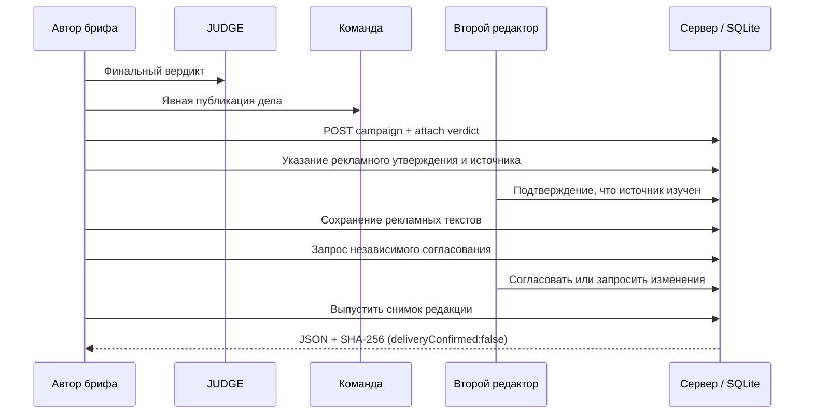

# ADVERSE JUDGE 0.15.0 — техническая реализация Waves 6–10

## 1. Product outcome

Предыдущие волны преобразовали пользовательское рекламное обещание в сохранённое дело, вердикт, а затем дали командную экспертизу и слепое сравнение. Новый маршрут:

`JUDGE verdict → workspace case share → campaign → documented source → human inspection → format-specific creative → independent editorial approval → editorial JSON release`.

Новый маршрут уже доступен в браузере и через авторизованный HTTP API. Все изменения сохраняются в SQLite. Система никогда не делает невыполненный внешний вызов «как будто состоявшийся».

## 2. Последовательность и роли

### WAVE 6 — Campaign Planner

- Не более 100 кампаний в рабочем пространстве.
- На кампаниях имеется `revision` начиная с 1. Значимое редактирование увеличивает ревизию.
- Бриф прикрепляется исключительно к делу, явно опубликованному в этой команде (`workspace_cases`), с действующим вердиктом и целым журналом JUDGE.
- Вердикт фиксируется как `case_id + verdict_id + snapshot`. После появления нового вердикта старый считается устаревшим.
- Снятие публикации дела предотвращает дальнейшее использование брифа и выгрузку связанного архивного релиза.

### WAVE 7 — Evidence Registry

- Автор хранит проверяемое утверждение, вид источника (`document`, `dataset`, `url`, `testimonial`), расположение, способ изучения, срок годности (если указан).
- Для `url` принимается только синтаксически корректный HTTPS URL без встроенных credentials; сервер не скачивает URL и не «подтверждает» его правдивость.
- Отметку «изучено» делает другой авторизованный участник. Нельзя самостоятельно заверить собственное утверждение.
- Если отметивший источник покинул команду или понижен до наблюдателя, прежняя отметка перестаёт удовлетворять требованиям выпуска. Новый редактор может переизучить документ.
- Данные источников ограничены командами; отсутствие проверки независимыми организациями явно отражено в UI.

### WAVE 8 — Approval Workflow

- Подать на согласование может редактор или владелец, но одобрить должен другой уполномоченный член команды.
- Запрос фиксирует конкретную редакцию кампании. После изменения содержания старая заявка становится `superseded`.
- Решение `approve` вызывает серверную `preflight`: нет устаревшего брифа, есть изученный источник с действующими полномочиями проверявшего и есть подходящий креатив.
- Смена членства/права источника также проверяется заново непосредственно перед выпуском.
- `approved` не означает юридически разрешённое или достоверно доказанное рекламное обещание.

### WAVE 9 — Creative Studio

| Канал | Макс. заголовок | Макс. основной текст | Макс. CTA |
|---|---:|---:|---:|
| search | 30 символов | 90 | 30 |
| social | 80 | 250 | 40 |
| email | 78 | 1200 | 50 |

- Все ограничения проверяются на сервере по Unicode code points (не отождествлять с правилами конкретного рекламного сервиса).
- RU, EN, 中文 поддерживаются как *выбор языка креатива*, но нет автоматического перевода через модель.
- `GET .../creatives?briefId=...` предлагает безопасную детерминированную подсказку из сохранённого брифа; это **не AI-генерация**, не внешняя рекламная аналитика.

### WAVE 10 — Release Center

- Выпуск возможен после актуального согласования другим участником и повторной проверки источников, креативов и прав доступа.
- Сохраняется снимок JSON со строго указанными полями (публикация на рекламной платформе **не выполняется**).
- `sha256 = SHA256(JSON.stringify(payload))`, сохранён в SQLite. На один номер редакции один выпуск.
- SQL-триггер запрещает UPDATE сохранённого пакета; DELETE при отзыве данных или удалении пользователя остаётся возможным.
- `npm run release:verify -- file.json` проверяет хеш и что `deliveryConfirmed` равен `false`. Злоумышленник с правом перезаписать payload и digest вместе может обойти такой контроль; это **не криптографическая подпись** и **не доказательство публикации**.
- Старые выгруженные JSON-пакеты у третьих лиц нельзя отозвать. Серверный доступ к прежним версиям повторно проверяет источники.

## 3. Хранилище: SQLite v12

Миграция `PRAGMA user_version=7 → 12` добавляет: `campaigns`, `campaign_briefs`, `campaign_evidence`, `campaign_creatives`, `campaign_reviews`, `campaign_releases`, `campaign_events`, индексы и запрет UPDATE релиза. Все миграции запускаются в транзакции. В тесте сохранены старые 8 событий, голос, исследование, 2 члена команды, история и сеанс, после чего новая кампания создаётся в старой команде.

События `campaign_events` хранят историю операций. **В отличие от журнала дел `event_attestations` предыдущей волны, журнал кампаний не имеет собственной цепочки HMAC; не заявляется, что он криптографически защищён от привилегированного переписывания.**

## 4. API-контракт

Все запросы требуют установленную локальную сессию; операции записи — CSRF-токен, Origin и ограничение частоты. Недостаточные права или обращение извне скрываются ответом 404, где нужно не раскрывать существование ресурса.

| Метод | Endpoint | Назначение |
|---|---|---|
| GET | `/api/production/campaigns?workspaceId=<uuid>` | Список кампаний доступной команды |
| POST | `/api/production/campaigns` | Создание (workspaceId, name, objective, audience, channel) |
| GET | `/api/production/campaigns/:id` | Кампания + источники + preflight + история |
| POST | `/:id/update` | Редактура полей и увеличение revision |
| POST | `/:id/attach` / `/:id/detach` | Привязка / отвязка явно опубликованного брифа |
| POST | `/:id/evidence` | Источник и утверждение |
| POST | `/:id/evidence/:evidenceId` | Независимая отметка об изучении |
| GET | `/:id/creatives?briefId=&channel=&language=` | Детерминированная подсказка |
| POST | `/:id/creatives` | Сохранение креатива |
| POST | `/:id/creatives/:creativeId` | Удаление креатива |
| POST | `/:id/review-request` | Запрос одобрения |
| POST | `/:id/review-decision` | Решение отдельного редактора |
| POST | `/:id/release` | Выпуск snapshot, повтор идемпотентен |
| GET | `/:id/export/:releaseId` | JSON-пакет с SHA-256 и запретом ложной отметки доставки |

Префикс сокращённой части таблицы: `/api/production/campaigns`. Большинство мутаций требует `expectedRevision`, иначе `409 VERSION_CONFLICT`.

## 5. Обработка отказов и privacy

- Отдельные роли `owner/reviewer/viewer`, ограничения команд, запрет самоодобрения, CSRF/Origin, синтаксическая валидация, лимиты кампаний/текстов.
- При удалении аккаунта вклад в чужие команды удаляется или аннулируется; ранее скачанные файлы остаются у получателей и не поддаются отзыву.
- Экспорт пользовательских данных включает собственные записи по кампаниям.
- Версии брифов и редакций не смешиваются; код не выдумывает внешние достижения.
- Нужны аудит конфиденциальности, юридическая проверка GDPR и защита реальных внешних интеграций до публичного запуска.

## 6. Реальная сфера готовности

Код работает как **локальный Node.js / SQLite пилот**. Нет подтверждённой доставки на 7 сайтов, их адреса не известны; нет сквозного SSO, почты, облачного Postgres, биллинга, проверенного многосерверного кластера или опубликованного HTTPS-домена. Продуктовая готовность оценивается по реальному коду и тестам, не по обещаниям маркетинга.
